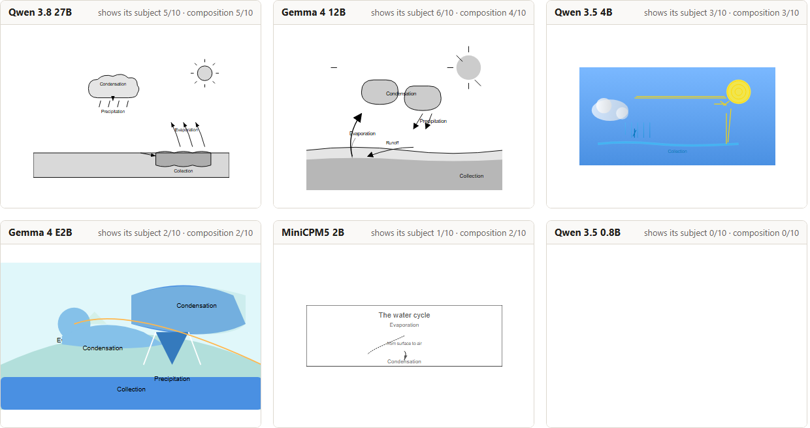
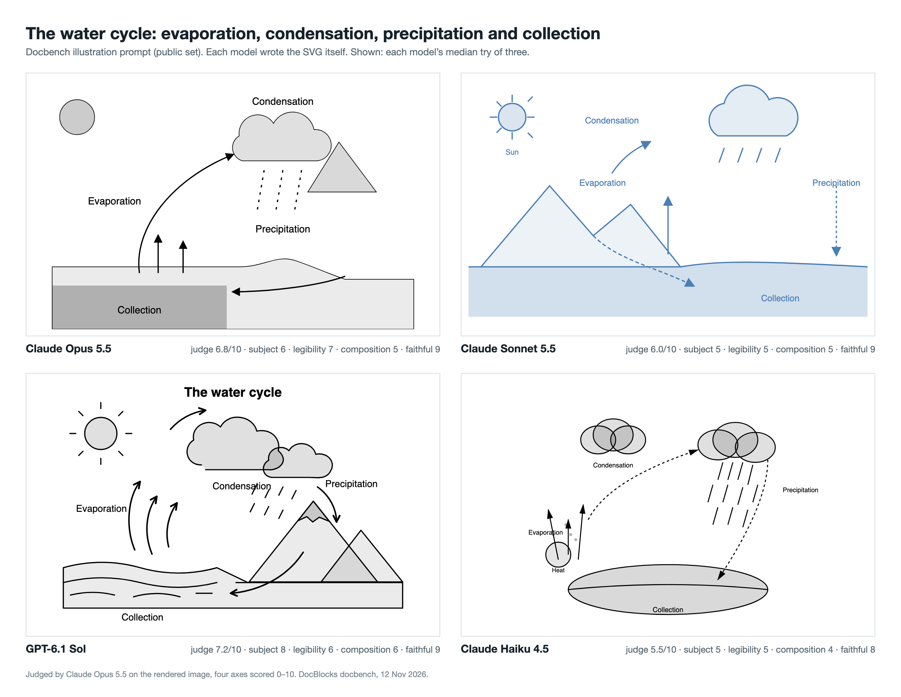

# Docbench: how small local models handle document work

DocBlocks recently added support for using local models to provide AI features for document tasks. You can select a model, it downloads, and you get basic features like document review and content editing.

<video src="screen-20261112-145823-edited.mp4" controls width="480"></video>

Pretty quickly, we ran into an obvious usability problem: how are users supposed to know which models to use, especially amongst a choice of a lot of models? Though we have some good measurements from Gezel's overall scorecard, we set out to measure and create a focused synthetic benchmark of model usability for documents. 

Separately, it was pretty obvious that models varied wildly on usefulness, correlated to model size. We needed a way to quantify that. Enter "docbench".

For docbench, we focus on really small models in the under-12-billion-parameter class. This is because we expect that the typical user will not be running on a workstation class machine with powerful video cards; rather, they'll run with modest GPUs or "just" a CPU by itself. Models that are in the 1-4 billion parameter range are typically runnable on conventional modern computers with at least 16gb of RAM, or a modern higher-end phone.

So towards that end, we scored 24 local models, from 0.8B to 35B parameters, on the work DocBlocks asks of them: reviewing, writing, diagrams, slides, study aids and transcript cleanup. From this, we created a 100 point weighted scale and included elements of static analysis and AI-based output judging. For comparison, we also compared against GPT 6.1 Sol, Claude Opus 5.5, and Claude Sonnet 5.5 via their CLI command lines.

Putting the headlines before the details: 

- Qwen 3.8 27B Q4 leads at 81 of 100, Gemma 4 12B is statistically level with it at 79, and the best models at 4B and under reach about 71.
- Review separates models most: large models find real problems, while 1–2B models pad their reviews with trivial or wrong suggestions.
- For comparison, modern cloud models score between 87 and 91, at least 6 points higher than the highest local model tested. Even historical cloud models (e.g., Claude Sonnet 4.6) have performed better.
- Although this rubric seemed to do a pretty good job of separating out lower-end models on real world tasks, I suspect if we had even harder editing and writing challenges, you'd see cloud models pull ahead farther. In other words, I believe cloud models probably topped out the difficulty of these challenges, but would be more differentiated on tougher challenges (reviewing a scientific paper, for example.)

## What docbench measures

Docbench covers every AI feature DocBlocks ships, grouped into six families and weighted by how much people rely on them. Each model answers the same 102 test cases (142 outputs, since tasks with variable output run three times), and every answer is scored 0–100.

| Family | Weight | What the model is asked to do | Cases | Score mix |
| --- | --- | --- | --- | --- |
| Review and feedback | 25% | Eight review styles: general, resume, facts and sources, conciseness, plain language, *The Elements of Style*, the UN editorial manual, creative ideas | 28 | 15% checks, 85% judge |
| Writing | 25% | Compose from scratch, append to a document, insert into one, rewrite a selection | 19 | 30% checks, 70% judge |
| Diagrams and illustrations | 20% | Pick what to illustrate, build diagrams of 13 kinds, draw SVG illustrations, write briefs for an image model | 30 | Checks only for picture ideas; 30/70 for the rest |
| Slides | 10% | Turn a document into slide suggestions for a deck | 8 | 30% checks, 70% judge |
| Study aids | 15% | Summaries, quizzes and flashcards that stay true to the source | 12 | 25% checks, 75% judge |
| Narration cleanup | 5% | Clean up a dictated transcript without changing what was said | 5 | 40% checks, 60% judge |

A family's score is the mean of its tasks, and docbench is the weighted mean of the six families. The test documents are deliberately moderate in quality, so a good reviewer has real problems to find. See Appendix A for more on how each result is calculated.

## The results

Across a few runs and two devices, we found that four models share the top band, a group of 4–9B models follows within 10 points, and scores fall quickly below 3B. Family scores are 0–100; the order is by docbench score. Note that download size loosely correlates to how much memory is occupied, though some models, like Nanbeige 4.2 are outliers in that they take up far more memory than their size implies.

| Model | Download | Docbench (95% range) | Review | Writing | Diagrams | Slides | Study | Narration |
| --- | --- | --- | --- | --- | --- | --- | --- | --- |
| Claude Opus 5.5 via Claude CLI 2 | -- | 89.5 (88.4-90.6) | 89 | 91 | 91 | 92 | 84 | 92 |
| GPT-6.1 Sol via Codex 2 | -- | 89.5 (88.4-90.4) | 88 | 93 | 90 | 94 | 83 | 92 |
| Claude Sonnet 5.5 2 | -- | 87.1 (85.8 - 88.2) | 83 | 89 | 90 | 91 | 84 | 84 |
| GPT-5.6 Sol via Codex | -- | 86.5 (84.8-88) | 84 | 92 | 87 | 88 | 81 | 85 |
| Claude Sonnet 4.6 2 | -- | 83.5 (81.6-85.2) | 78 | 88 | 85 | 91 | 77 | 86 |
| Gemma 4 31B 2 | 17.57 GB | 83.1 (80.7-83.8) | 74 | 89 | 85 | 84 | 78 | 89 |
| Claude Haiku 4.5 2 | -- | 81.5 (80.1-82.9) | 71 | 89 | 88 | 87 | 79 | 90 |
| Qwen 3.8 27B Q4 | 16.5 GB | **81** (79–82) | 72 | 89 | 82 | 89 | 74 | 86 |
| Qwen 3.8 27B Q2 | 9.8 GB | **79** (77–81) | 69 | 87 | 78 | 89 | 74 | 87 |
| Gemma 4 12B 2 | 6.7 GB | **79.7** (77–81) | 70 | 83 | 84 | 86 | 72 | 88 |
| Gemma 4 26B-A4B | 14.5 GB | 79.2 (77.7-80.7) | 67 | 88 | 83 | 89 | 73 | 85 |
| Qwen 3.6 35B-A3B (MoE) | 22.7 GB | **76** (73–79) | 61 | 89 | 73 | 89 | 74 | 86 |
| Ornith 1.5 9B | 5.6 GB | **73** (71–75) | 50 | 87 | 78 | 86 | 73 | 77 |
| Gemma 4 E4B | 4.2 GB | **73** (71–75) | 52 | 86 | 74 | 86 | 69 | 86 |
| Qwen 3.5 9B | 5.9 GB | **72** (70–74) | 52 | 87 | 72 | 84 | 71 | 82 |
| Qwen 3.5 4B | 2.8 GB | **71** (69–72) | 47 | 85 | 77 | 85 | 67 | 79 |
| Nanbeige 4.2 3B 1 | 2.7 GB | **71** (68–73) | 53 | 83 | 71 | 83 | 69 | 79 |
| Nemotron 3.5 Bolt E4B | 6.2 GB | **69** (67–72) | 50 | 85 | 66 | 82 | 68 | 83 |
| GPT-OSS 20B (MoE) 1 | 11.7 GB | **67** (64–69) | 40 | 83 | 73 | 79 | 67 | 75 |
| Granite 4.2 8B | 5.3 GB | **66** (63–68) | 38 | 82 | 69 | 82 | 67 | 76 |
| Gemma 4 E2B | 2.6 GB | **64** (61–66) | 40 | 74 | 69 | 80 | 65 | 72 |
| MiniCPM5 2B | 1.6 GB | **59** (57–62) | 35 | 74 | 60 | 75 | 59 | 75 |
| Granite 4.2 3B | 2.2 GB | **59** (56–61) | 33 | 74 | 60 | 78 | 59 | 67 |
| Qwen 3.5 2B | 1.3 GB | **56** (53–58) | 30 | 74 | 51 | 75 | 55 | 71 |
| LFM3 1.7B† | 1.0 GB | **55** (52–58) | 30 | 68 | 70 | 76 | 57 | 13 |
| Apple Foundation Models 2 3 | -- | 54.4 (51.7-57.1) | 26 | 78 | 45 | 73 | 55 | 75 |
| Llama 3.2 3B† | 2.0 GB | **54** (51–56) | 32 | 66 | 56 | 64 | 53 | 68 |
| LFM2.5 2.6B† | 1.7 GB | **47** (44–49) | 40 | 72 | 50 | 0 | 57 | 0 |
| Qwen 3.5 0.8B | 0.5 GB | **43** (40–45) | 20 | 56 | 32 | 70 | 46 | 67 |
| MiniCPM5 1B | 0.7 GB | **37** (35–40) | 14 | 54 | 32 | 63 | 34 | 47 |

† - Custom license: scored, but DocBlocks never recommends them. "E4B" and "E2B" models run like 4B and 2B models but carry more parameters in embeddings.

1 - Re-measured after two fixes to Gezel

2 - Run in a second pass on a different device, but with the same software. Comparison tests for similar models were +/- 1.3 points judged, likely sampling noise

3 - For Apple Foundation Models, about 3 of its points are lost because all 12 illustration cases score zero because DocBlocks only offers illustrations on a 16K+ context, and Apple has 8K

A few results stand out:

- **Writing is easy; review is not.** Writing scores run from 54 to 89; review runs from 14 to 72, and it is the weakest family for every model in the top two bands.
- **A 2-bit 27B nearly matches its 4-bit build.** Qwen 3.8 27B at Q2 scores 79 in 9.8 GB, level with Gemma 4 12B and ahead of every other model that size.
- **Bigger is not always better.** The 35B mixture-of-experts model and GPT-OSS 20B (an older model) both trail the dense 12B Gemma, mostly on review.
- **Zeros mean the output was unusable.** LFM2.5's slide and narration answers ran past their length limits every time, so DocBlocks could show nothing.

## Review differences

Perhaps not surprisingly, every model is better at finding typos than at structure.

To test review capability we bucketed planted issues in a document into small, moderate, and substantial problems that models could find:

- **Small** covers basic grammatical fixes, doubled words, misspellings, and subject verb agreement
- **Moderate** covers broader stylistic issues with content. For example, passive and vague language, wordiness
- **Substantial** covers more document-level feedback. For example, factual contradictions in the document, conflicting references to previous sections, or statements first made in the concluding summary of a document

More specific review styles plant problems of their own kind:

- **Fact check.** A water-works notice advises residents to boil their water "because boiling water removes lead". It does not (it can concentrate lead), so the safety advice is wrong. Smaller plants include arithmetic slips, such as "36 (60%)" when 36 of 48 is 75%.
- **Resume.** Flagging duties instead of accomplishments ("Responsible for maintaining the internal reporting dashboard"), results with no number ("Improved page load time on the analytics site"), and jobs out of reverse-chronological order.
- **Policy.** "It applies to all full-time employees" contradicts a later section that gives part-time staff remote days, and "core hours" are required but never defined.

One of the top local models finds 92% of the planted small problems but only 10% of the substantial ones, and models under 2B add more trivial or wrong suggestions than real ones. A "trivial" suggestion restates the text or praises it ("This is a correct sentence"). It costs the reader time without improving the draft, so it counts against the model like a wrong one. Some documents have nothing wrong with them at all. A model that invents problems there loses points.

These counts come from the general review task: four moderate-quality documents with about eight planted problems each.

| Model | Real suggestions per document: small · moderate · substantial | Trivial per document | Wrong per document | Planted problems found: small · moderate · substantial |
| --- | --- | --- | --- | --- |
| Qwen 3.8 27B Q4 | 2.8 · 2.0 · 0.3 | 0.0 | 0.0 | 92% · 73% · 10% |
| Gemma 4 12B | 2.5 · 1.5 · 0.5 | 0.3 | 0.0 | 83% · 55% · 20% |
| Qwen 3.6 35B-A3B | 2.7 · 1.3 · 0.3 | 0.3 | 0.3 | 78% · 50% · 13% |
| Ornith 1.5 9B | 2.5 · 0.8 · 0.3 | 2.0 | 1.0 | 83% · 36% · 40% |
| Qwen 3.5 9B | 1.8 · 1.0 · 0.8 | 0.5 | 0.5 | 58% · 55% · 30% |
| Qwen 3.5 4B | 1.0 · 0.3 · 0.3 | 0.8 | 0.8 | 33% · 18% · 10% |
| Gemma 4 E2B | 1.3 · 0.8 · 0.0 | 1.3 | 1.5 | 50% · 36% · 10% |
| MiniCPM5 2B | 1.7 · 0.3 · 0.3 | 1.3 | 1.3 | 56% · 13% · 13% |
| Qwen 3.5 0.8B | 0.7 · 0.0 · 0.0 | 3.3 | 0.3 | 33% · 0% · 0% |
| MiniCPM5 1B | 0.0 · 0.0 · 0.3 | 3.3 | 1.0 | 0% · 0% · 10% |

### Images and Diagrams

Freehand drawing separates models more than any other task, while diagrams (rendered via strict schema'ed JSON) barely do. Asked for an SVG picture of the water cycle, the largest models drew a recognizable scene with all four stages labeled; the smallest drew loose shapes with no cycle, or nothing at all.

| Model | SVG illustrations (0–100) | Shows its subject (0–10) | Composition (0–10) | Diagrams (0–100) |
| --- | --- | --- | --- | --- |
| Qwen 3.8 27B Q4 | 79 | 6.3 | 5.8 | 91 |
| Qwen 3.6 35B-A3B | 73 | 6.3 | 4.8 | 91 |
| Gemma 4 12B | 66 | 5.1 | 3.7 | 91 |
| GPT-OSS 20B | 62 | 4.9 | 3.9 | 91 |
| Gemma 4 E4B | 60 | 3.9 | 2.5 | 89 |
| Qwen 3.5 4B | 55 | 3.0 | 2.3 | 85 |
| LFM3 1.7B | 52 | 2.1 | 1.5 | 85 |
| Gemma 4 E2B | 51 | 2.3 | 1.7 | 76 |
| Qwen 3.5 0.8B | 25 | 1.0 | 0.6 | 55 |
| MiniCPM5 1B | 14 | 0.0 | 0.2 | 41 |

The gap comes from who does the drawing:

- **For a diagram, DocBlocks draws.** The model only fills in a structured spec (JSON to a schema) — which kind of diagram, which boxes, labels and links — and DocBlocks renders it, so the picture is always clean. Most models from 3B up score 85–91, and even LFM3 at 1.7B reaches 85.
- **For an illustration, the model draws.** It writes the SVG itself: every coordinate, shape and label position. That takes spatial planning that small models do not have.
- **Even the best drawings are modest.** Qwen 3.8 27B averages 6.3 of 10 for showing its subject: simple, labelled scenes, closer to clip art than to illustration.
- **Small models rarely invent, they just cannot draw.** Most score 5–9 of 10 for faithfulness to the source while scoring 1–3 for showing the subject.
- **Some failures are invisible in the code.** Qwen 3.5 0.8B's water cycle is valid SVG that draws nothing: its styling made every label transparent and it drew no shapes. That is why the judge grades the rendered picture, not the SVG source.

Six models' answers to the same water-cycle prompt, with the judge's grades:

Here are the cloud equivalents:

## Summary

This set of tests clearly shows that there is a wide-open range of capability available for consumer-grade hardware: from barely able to coherently review, to useful functionality, to near-frontier quality. 

The guidance is still simple: pick the highest band your machine can hold. DocBlocks does this for you: its model list ranks downloadable models by docbench among those that fit your computer or phone. 

As a rough guide by download size:

- **Lots of GPU or unified memory:** Qwen 3.8 27B at Q4 (16.5 GB), the top score.
- **About half that:** Qwen 3.8 27B at Q2 (9.8 GB) or Gemma 4 12B (6.7 GB), both in the top band.
- **A typical laptop:** Gemma 4 E4B (4.2 GB, 73) or Qwen 3.5 4B (2.8 GB, 71).
- **Phones and small machines:** Gemma 4 E2B (2.6 GB, 64). Below 2B, writing help is still usable, but reviews are mostly noise.

Gemma 4 12B is the sweet spot: strong enough to be genuinely useful, small enough to run on most modern PCs and Macs. Free, private, and good enough for real document work. It offers promise that local models can provide real value to wide user bases for free, besides the hardware and electricity cost.

## Appendix A: More Measurement Details

Every answer goes through the same code a real DocBlocks request does, then gets automatic checks and a grade from an AI judge.

1. **The product's own path.** The benchmark calls DocBlocks' real pipelines — its prompts, parsers, repairs and retries — through Gezel, the local model runtime DocBlocks uses, with each model's catalog settings applied. The model sees exactly what a user's request would send, with the date and random seeds fixed.
2. **One modest setup for every model.** Each model ran on llama.cpp, mostly as a 4-bit (Q4) build, with a 32,768-token context: what Gezel gives a constrained laptop.
3. **Automatic checks.** First: could DocBlocks use the answer at all? It must parse, apply cleanly to the document, finish without being cut off, and keep the source's numbers and names. An answer DocBlocks could not show you scores 0.
4. **A judge for quality.** Claude Opus 5.5 grades each usable answer against a written rubric for its task. Drawings are judged as rendered pictures, not as code.
5. **Answer keys for review.** Each review document has planted problems tagged by how much fixing them changes the draft: small (a typo), moderate (a sentence) or substantial (structure, a contradiction, a buried point). The judge marks which ones a model found and labels each suggestion valid, trivial or wrong. Review is scored on finding problems (substantial ones count three times a small one) without padding, and clean documents with nothing to find penalize invented problems.
6. **Ranges and bands.** A bootstrap over cases and repeat runs gives each score a 95% range. Models whose ranges overlap share a **band**, the fairest way to read the order.

Speed is not part of the score; a slow model that writes well still scores well.

### Is the test fair?

The judge passed three consistency checks before any score was published, and a private test set ranked models the same way as the public one.

- **It grades the same answer the same way.** Re-grading a sample moved scores by 0.16 points on a 0–10 scale on average; the limit was 0.7.
- **A second judge agrees.** Claude Sonnet 5.5 graded the same sample, with agreement of 0.84 (Krippendorff's alpha; 0.6 was the bar).
- **It cannot be fooled by damaged answers.** We degraded good answers by cutting them short, padding them, changing their numbers, or turning review findings into "this sentence is correct". The judge marked them down 2 points or more in 56 of 62 cases (90%, the bar), and was weakest on list-like answers such as quizzes and slide points.

We also kept 32 test cases private and ran five models on them. If prompts had been tuned to the public documents, models would do worse on the private ones. They did not: the order is identical, and every model scored slightly higher on the private set.

| Model | Public set | Private set (95% range) | Difference |
| --- | --- | --- | --- |
| Qwen 3.8 27B Q4 | 80.7 | 82.6 (80–85) | +1.9 |
| Gemma 4 12B | 78.8 | 81.3 (80–83) | +2.5 |
| Qwen 3.5 4B | 70.7 | 71.2 (68–74) | +0.5 |
| MiniCPM5 2B | 59.3 | 65.6 (63–69) | +6.3 |
| Qwen 3.5 0.8B | 42.7 | 43.6 (40–47) | +0.9 |

Family scores moved by up to 16 points between the two sets, because each family rests on few cases. Rank models by the overall score and band, and read family scores as a profile.

### What these numbers do not tell you:

- **Other setups.** Every model ran on one machine (an NVIDIA RTX Spark N1X with 23 GB of memory available), on llama.cpp, with a 32K context. Other engines and quantizations will score differently.
- **Speed.** It is not scored. On the test machine, the full benchmark took 7 minutes for Gemma 4 E2B and 4.4 hours for the 35B mixture-of-experts model.
- **Anything outside English documents.** All test documents are in English.
- **Certainty from an AI judge.** The judge passed its checks, but it is still a model, and it was weakest on list-like answers.
- **Comparisons across versions.** Scores compare within one docbench version (0.2); a new version re-measures every model.

