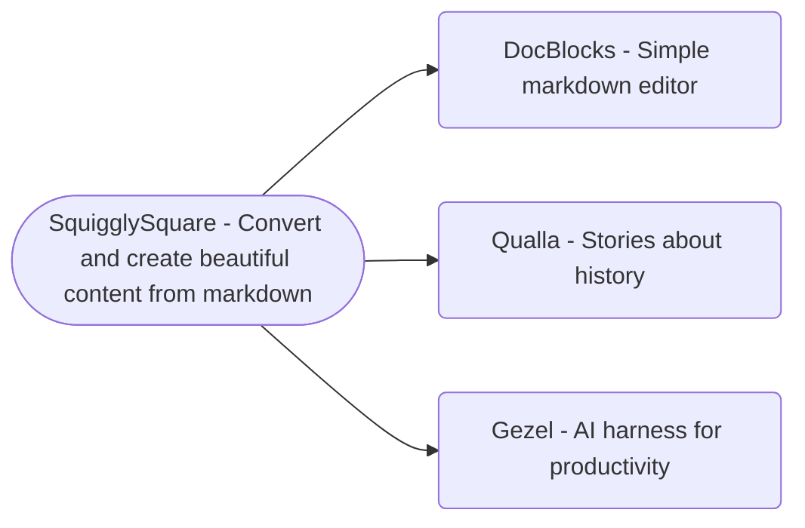

## DocBlocks and how Gezel works as an API

[DocBlocks](https://docblocks.com) started off as a simple markdown editor, but the vision has always been to let you do more with your content. Convert to video. Save off web pages. Produce slideshows. Quiz via flashcard. Act as a teleprompter. Write a blog post that saves as HTML, like I'm doing now. More!

[https://www.youtube.com/watch?v=dark9Bq6CZE](https://www.youtube.com/watch?v=dark9Bq6CZE)

With the latest release, we're taking our biggest step yet: adding AI, dictation, and narration capabilities. Given that I also have local-AI based framework Gezel and had already added speech capabilities there, it's probably no surprise that I wanted to extend that power to DocBlocks. A DocBlocks x Gezel collab, if you will.

This article is a little bit of how that happened. If you're building your own apps or workflows and are thinking about AI, think of DocBlocks as a case study of how you can embed AI for free in your own apps and workflows.

### The Background

DocBlocks started off as a predominantly web based markdown editor -- just a free, simple notepad for the internet. Simple, light, uncomplicated.

But I always had this ambition that you can use it as a full spectrum content editor. I needed something to create videos like you're watching right now, and this started off as a script in DocBlocks.

Separately, I've been working on qualla.com, and trying to see how I can build more compelling stories from just a packet of text.

### Squiggly Square: Core content engine {[factCard]}

For both of these cases, I developed squiggly square (squiggly square.com) libraries and engine -- kind of a Swiss army knife for content, that can take and produce videos or slideshows or flashcards. The engine is free, open source (and uses a lot of open source), and you can use it in your apps. [github.com/bendyline/](http://github.com/bendyline/)squisq.

DocBlocks is, for the most part, just a gigantic wrapper around squiggly square. Notepad for markdown, but you can do cool things with it.

### Adding speech to text (dictation) and text to speech (narration)

Two major improvements to DocBlocks come in the form of dictation and narration.

For a content creation app, it's nice add to support speech to text (dictation) and text to speech (narration). Dictation is nice because sometimes you just want to start with some stream of consciousness writing. Also, dictation can be used to transcribe videos and audio. Narration is interesting because, well, just a personal thing of mine but I find having narration read back my document is my preferred proofreading tool, maybe because I'm too lazy or attention-scattered to read long content on my own. Also, it can be used to create narrated videos automagically.

For speech to text and text to speech, there are some awesome open source toolsets for these: Whisper libraries for dictation, and Kokoro libraries for narration. 

### Enter AI

AI is useful for a lot of things. It always starts with review: having anything that can review your content and spot flaws is useful, even if you only take their suggestions 25% of the time. And then have it make the fixes for you.

Consider also: content cleaning: the amount of time that people spend restructuring text and data. A lot of times, content comes from other places, or needs to be reorganized and cleaned, and AI is useful for that kind of mechanistic work. Finally, I'm convinced that there are a lot of ideas for how to combine AI into productivity applications that haven't been explored yet.

You can also use AI to write content for you, but for communications like this I prefer to keep it to my own authentically crappy writing, especially when I'm narrating it, like I'm doing now. 

### How it looks {[rightFeature]}

So, one exercise was to see how we could use all these systems together to have DocBlocks essentially create its own launch video. I've put that video up on YouTube, here:  

[https://www.youtube.com/watch?v=bw1XFC6JcFA](https://www.youtube.com/watch?v=bw1XFC6JcFA)

The process for creating this is as follows:

1. I started with a paragraph and some bullets about what I wanted to say about the new release - the major new features.
2. AI is off by default in DocBlocks. So one time only in DocBlocks, you'll need to turn on AI in Settings.
3. The first time you use it, you'll likely need or want to download a model (on Macs, you can use Apple Intelligence if you so choose, which is okay, but if you have more space and 16gb+, you probably want to download a model)

  For this video - I had beefier hardware on Windows and I used Qwen 3.8.

4. In the Sparkle menu, I could use AI to expand the seed bullets into prose which will become the narration.
5. Then, review the content that has been expanded by AI!
6. Even though we just took some bullets and expanded it into prose, we want to ensure we've got nice summarized slides so that we can have some animations that follow. So, in Slideshow view, select the Design next to Summarize, and select "Suggest with AI"
7. Then, export the result as a video (MP4)

And voila! in 20 minutes, you can have a fully animated presentation based on your ideas. You can spend all of your time focusing on the ideas, and leave the rest (styling; grammar checking; video producing) to DocBlocks associated tools.

To be clear, there was some bugs in the process. The audio mispronounced some words (since fixed.) And the slides are not bad but not as good as they could be. 

One thing that's next is improving the look of slides by increasing the arsenal of visualization effects that AI can use.

### Gezel as an AI API

For AI, I'm using Gezel as an API surface, embedded inside of DocBlocks. It is designed to be a flexible AI engine that you can use as programming interfaces or from the command line. Embedding Gezel in DocBlocks gives us a lot of benefits:

- It handles a lot of the infrastructure of managing local models: downloading, managing, hosting the various native engines, integrating with Apple Intelligence, etc.
- Gezel has a catalog of models to use, and behind those models, there are dozens of hours of evals and tuning behind them. See the model scorecards in the description for more information on our testing. We harness this to make it nearly automatic to find the best model that fits across diverse hardware: phones to 5-year-old GPU-less Windows machines to modern fire-breathing Macbooks
- We can bring across systems like downloadable knowledge packages inside of gezel.
- Gezel supports all major platforms: Windows (x64 and Arm), Mac, Linux (x64 and Arm), and even Android and iOS, and abstracts you from a lot of those differences in those platforms
- Optionally, if Gezel is installed, you can connect to Gezel from DocBlocks so that you have a central engine for "air traffic controlling" different AI requests
- Very soon, we'll also support image rendering. Stay tuned :)
- It's free and open source, and I'm happy to help anyone integrate it! Ping me at mikeamm@bendyline.com

### Knowledge in action

Let me give you a case study in how the experience of Gezel makes this a better app.

One task I ask AI to do is to write a report about the Panama Hotel in Seattle. It's an example of a more obscure topic that most AI "won't know off the top of its head", and it's a test of how AI does research. The Panama Hotel is a local hotel that has an interesting history connected to the Japanese-American community. It was also the place where a lot of Japanese Americans during World War 2 brought their belongings before they were cruelly sent to internment camps during World War 2.

Without any additional infrastructure, even good models like Qwen 3.8 will just fabricate a report. Qwen wrote an article that it was a hotel built in 1905 (it was completed in 1910), in the Pioneer Square neighborhood of Seattle (not really), and just give a generic description of a nice hotel. None of the critical Japanese-American actual history. Because I can leverage Gezel's knowledge system, if I just download the Pacific Northwest knowledge catalog, I can have it fact check everything and it writes a much more relevant report about this hotel, including its full history. Also, gezel exposes a "factual" mode prompt which forces AI enumerate all the facts in its report, highlight them, and cite its sources. We reject doing any AI writing for factual topics if no sources can be found, and we attempt to highlight potential facts that may not have full sourcing These are all services that Gezel provides.

### The Downsides

The only problem with all this is that it's now added to the size of DocBlocks as a downloadable package. 100s of megabytes of the install are now spent on things like a "CUDA runtime" (does that make DocBlocks the first CUDA powered text editor?) But I'm not sure that anyone cares if their apps are 1gb in size anymore. How far we've come.

Also, I get that some people might think AI is bad or unwelcome, I get that. I focus on local AI so that it's fully in control, with no bill. And there is a history of bad AI experiences that randomize more than they help. But even that said, AI is off by default, and STT and TTS don't do anything until you download the 100+mb dependency files.

### The Implications

First, check out DocBlocks! I use it as my core notetaking and content production app. It's certainly rough around the edges and could stand to be better, but we're getting there!

Second, if you're building applications, check out the emerging capabilities we have in gezel for harnessing local AI to improve the experience of your apps. Like DocBlocks, it's free and open source. If you have use cases for your software or inside of your company, please reach out! I'd love to help you harness the power of free, private local AI in your apps.

### Summary

To sum up - check out the newest version of DocBlocks if you get the change - download the apps for free from docblocks.com/desktop. I would love your feedback on how to make DocBlocks your trusted confidant for working with your most precious expressions. 

If you're building applications and need to use AI, consider using Gezel as a framework. It's also free and open source - no catches! See our docs for more. 

If you have feedback - please let me know! Reach out at [mikeamm@bendyline.com](mailto:mikeamm@bendyline.com)

-- Mike
