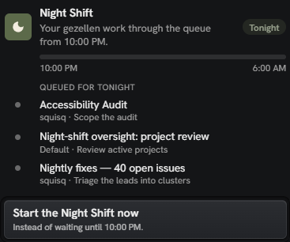
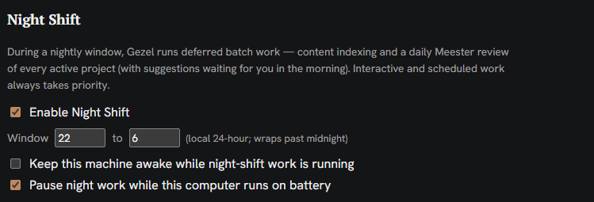
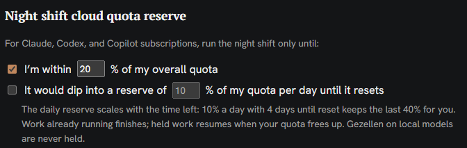
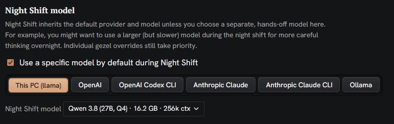
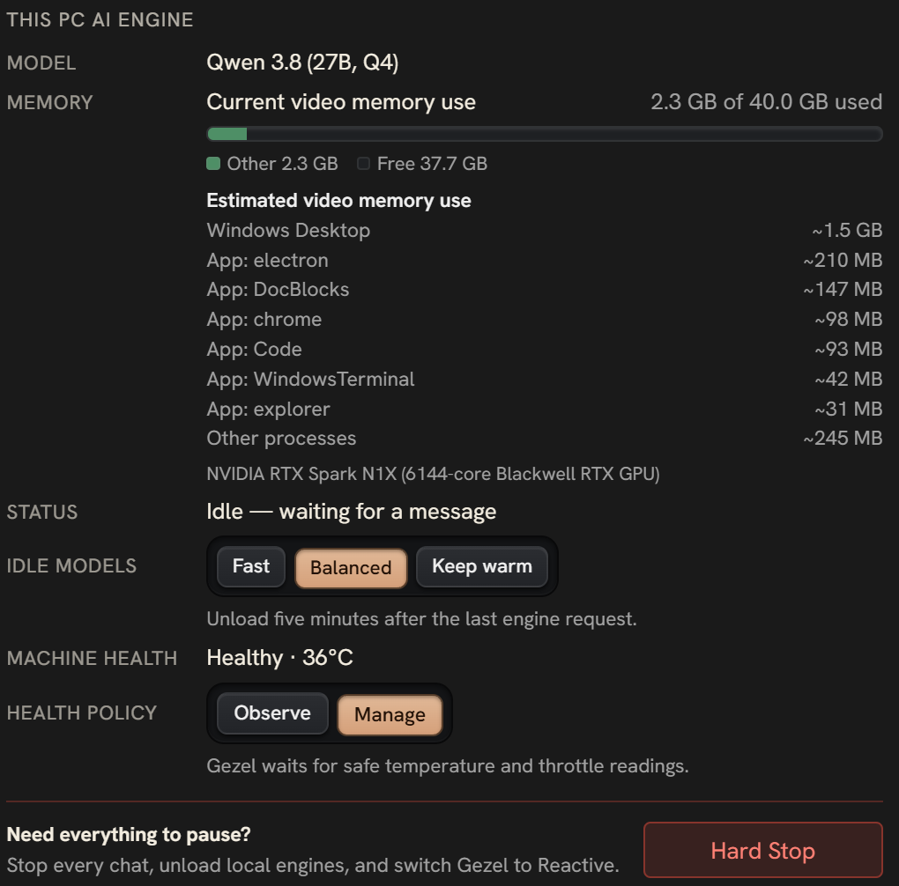
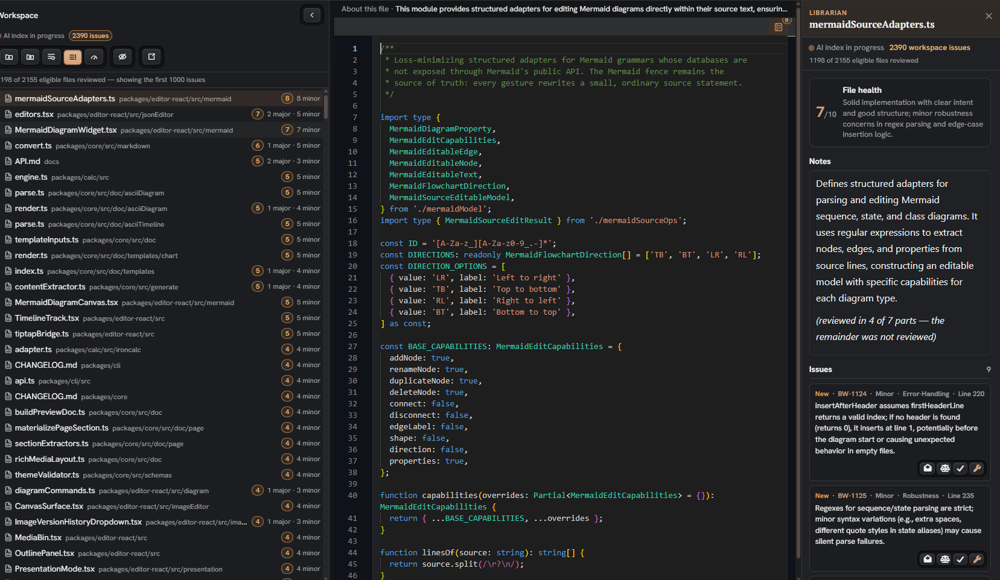

## Indexing and the Night Shift in Gezel

Gezel ([gezel.com](http://gezel.com)) uses the power of local AI models to assist you with work. Admittedly, local AI models are not nearly as powerful as cloud models, but for so many tasks, they can be so useful and get the job done. One benefit from local AI is that you can run them on the hardware you already have, or that you can easily acquire, and to complement the work you're already doing.

But going further: what if you could put your expensive hardware to work when you aren't using it, to assist you when you need it? What if you could have it working nearly around the clock, "for free" (besides electricity) - to help you out?

### Night shift {[bottomFeature]}

Enter the night shift (cue the Commodores). This is a dedicated period—say, between 10pm and 6am—when you’re away from your device. During this window, Gezel takes over, pushing your hardware to its limits to complete a queue of pending tasks for your benefit.

More than a passive scheduler or cron job, the night shift is proactive. Its core design principle is near-total automation, aiming to deliver tangible value every morning. Wherever possible, and based on the files and folders and connections you give to it, Gezel is honed to anticipate needs and execute tasks on your hardware, unbidden.

A related design tenet is that night shift needs to be reliable and trustworthy. You shouldn't wake up in the morning to a broken build that your AI broke. For that reason, under default settings, Gezel cannot modify files in the folders you share -- it's all read only. (Gezel can prepare reports and aggregate data off to the side in its own folders, though.) If Gezel wants to propose a fix to your code, it prepares a diffpack of changes, which you can review and approve in the morning. Any other actions go into a queue of proposals that you can accept or deny.

The ultimate goal of the night shift: let you sleep soundly.

### Also: Use your cloud account to its fullest

While Gezel focuses on local AI, we recognize that many users also hold personal Claude or ChatGPT accounts. These services often operate on a use-it-or-lose-it weekly token allowance. Rather than manually optimizing to squeeze out every last token before a quota reset (or a whimsical reset by the provider), you can leverage Night Shift to do it automatically. You can use Night Shift o that it will use up to an increasing portion of your weekly cloud quota for night shift activities. For example, use up to 60% of your quota 2 days before my quota resets, 80% of my quota one day before my quota resets, etc. This leaves you buffer during the day during queries, but makes sure you're on target to use the tokens you're granted.

### Run models of the largest size

There is a hidden benefit as well, in the context of local AI. Sometimes -- and this depends on your hardware -- local AI can feel really slow compared to cloud AI. AI speed is measured in "tokens" per second, and snappy-feeling cloud AI runs typically at 60+ tokens/per second. When doing back and forth coding, it's tolerable to run AI at 20 tokens per second. But we've seen across hardware that a lot of devices can run really advanced models locally and faithfully. They just... do it slowly. At 10 to 15 tokens per second. Furthermore, local AI suffers from 'prefill time'—the delay to load a prompt, which can range from 1 to 2 minutes and increase with tool complexity. Unlike cloud environments where models are warm and ready, this latency makes interactive coding with large local models like Qwen 3.8 or Deepseek 4.1 Flash feel sluggish, despite their impressive capabilities.

However, when these powerful models run overnight while you sleep, their slower speed becomes largely irrelevant.

Towards that end, we have a special mode for selecting a model to use during the night shift: the idea being, you can use a big expensive but slow local model. If you're using cloud accounts, you can use this dropdown to do the reverse direction: use an advanced model like Opus in your daily work, but use a more cost effective model like Luna or Haiku during the night shift.

In a standard workweek, you have five overnight windows where your hardware can work for you.

### Keeping your Hardware Healthy

One other small note: while it's a goal of Gezel to keep your hardware working for you while you sleep, Gezel has built-in health monitoring to keep an eye on the performance of your hardware. It can automatically pause or hold back tasks if your device is running too hot, especially on Windows/Linux where you may be using higher-end discrete GPU hardware. You can add cooldown thresholds and manage temperature to your (and your devices) level of comfort. 

So what can you get done during the night shift? Lots! Let start with indexing.

### Indexing

Agentic indexing is a core concept in Gezel. Whether you are working with code repositories, documents, or images, pre-building a semantic index significantly enhances LLM performance, particularly for local models. Consequently, adding a folder to Gezel automatically triggers this indexing process. We do indexing in a few layers:

1. we do semantic indexing to help with search. Here, we use a standard embedding model to build out a semantic index
2. lots of fixed function analysis wherever we can do things like code analytics
3. If you have a folder full of media - images, videos, or MP3s - then we automatically transcribe them or summarize them
4. We summarize documents via AI
5. We attempt to rate the health of the document: for code, this might be the number of coding inconsistencies that we see.  For traditional content documents, this might be an assessment of grammatical issues. More on that, below:

### Finding Problems and Smells

The night shift leverages AI for continuous code review. On a file-by-file basis, your local AI scans for errors, grammatical issues, and 'code smells,' effectively performing a weekly audit of your entire codebase. This process not only identifies problems but also assigns a health score to each file:

### Tasks

The night shift also enables proactive task execution. By adding a 'crew' of AI agents—such as developers or reviewers—to your project, you can assign them specific responsibilities. For instance, a developer agent can proactively generate 'diff packs' containing recommended code fixes, which you can review and approve the following morning.

### Search: An attempt was made

With this rich semantic and AI index in place, you might expect it to enhance all LLM tasks. The reality is more nuanced.

One of the key facets of Gezel is an integrated search tool that searches across knowledge, your documents, and your files and folders. And we know that that is instrumental for local LLMs to be effective, especially since they typically do not have a great set of search tools in the default configuration. And certainly for your domain expertise and your context, search is how your "brain" makes AI better. So for any models you use in Gezel, integrated search is a key tool.

While we hypothesized that integrated search would benefit advanced models like Opus 5.5, the data suggests otherwise. Frontier cloud models, when offered a search tool, rarely use it—likely because they rely on their internal knowledge base.

To address this, we used [AGENTS.md](http://AGENTS.md) to explicitly instruct the AI to utilize Gezel's search tool. The results were mixed. For models below Opus 5.5, enforced search usage improved efficiency, reducing token costs by 19% and time by 33%. Notably, a placebo test—simply instructing LLMs to search without the tool—also reduced token spend by approximately 14%.

Conversely, for advanced models, using Gezel search slowed performance compared to the control group, as these models spent additional time reasoning over search results alongside their native actions.

So: we have an awesome search MCP tool that runs with your index, but we can't recommend using it with the cutting-edge of models. But for local AI, it is useful.

| Agent | Tool calls without Gezel (median) | Time without Gezel | Called Gezel's search | Cost vs no Gezel | Time vs no Gezel |
| --- | --- | --- | --- | --- | --- |
| Sonnet 5 (main trial) | 22 | 119 s | 116 of 120 | −19% (−27% to −10%) | −33% (−42% to −22%) |
| Sonnet 5.5 | 11 | 39 s | 40 of 40 | 0% (−6% to +6%) | 0% (−7% to +7%) |
| Sonnet 5.5, t1c | 11 | 37 s | 40 of 40 | +1% (−3% to +5%) | +1% (−3% to +6%) |
| Opus 5.5 | 8 | 73 s | 16 of 40 | −1% (−6% to +4%) | −3% (−9% to +3%) |
| Codex (main trial) | 7 | 60 s | 120 of 120 | +16% tokens (+7% to +26%) | +9% (+5% to +14%) |
| Codex, t1c | 7 | 59 s | 40 of 40 | +13% tokens (+2% to +26%) | +10% (+6% to +15%) |

