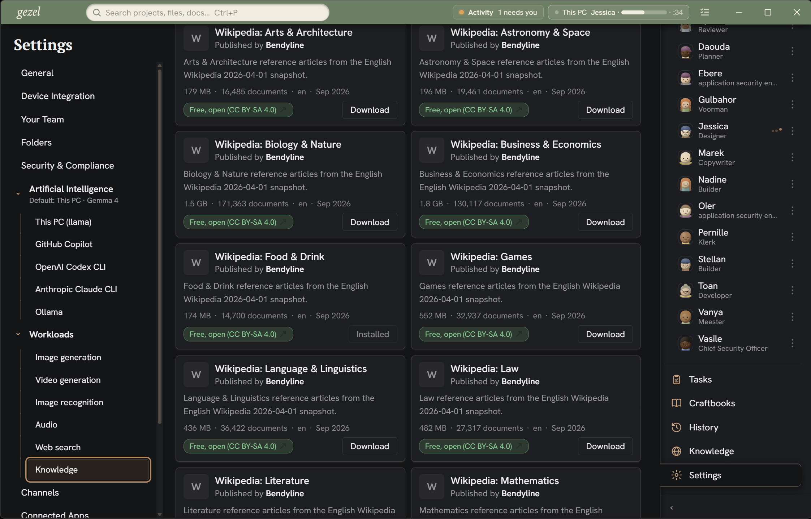
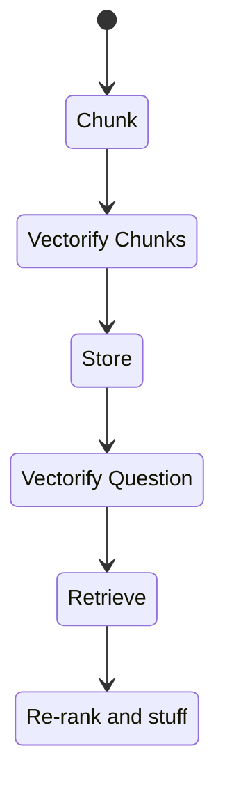
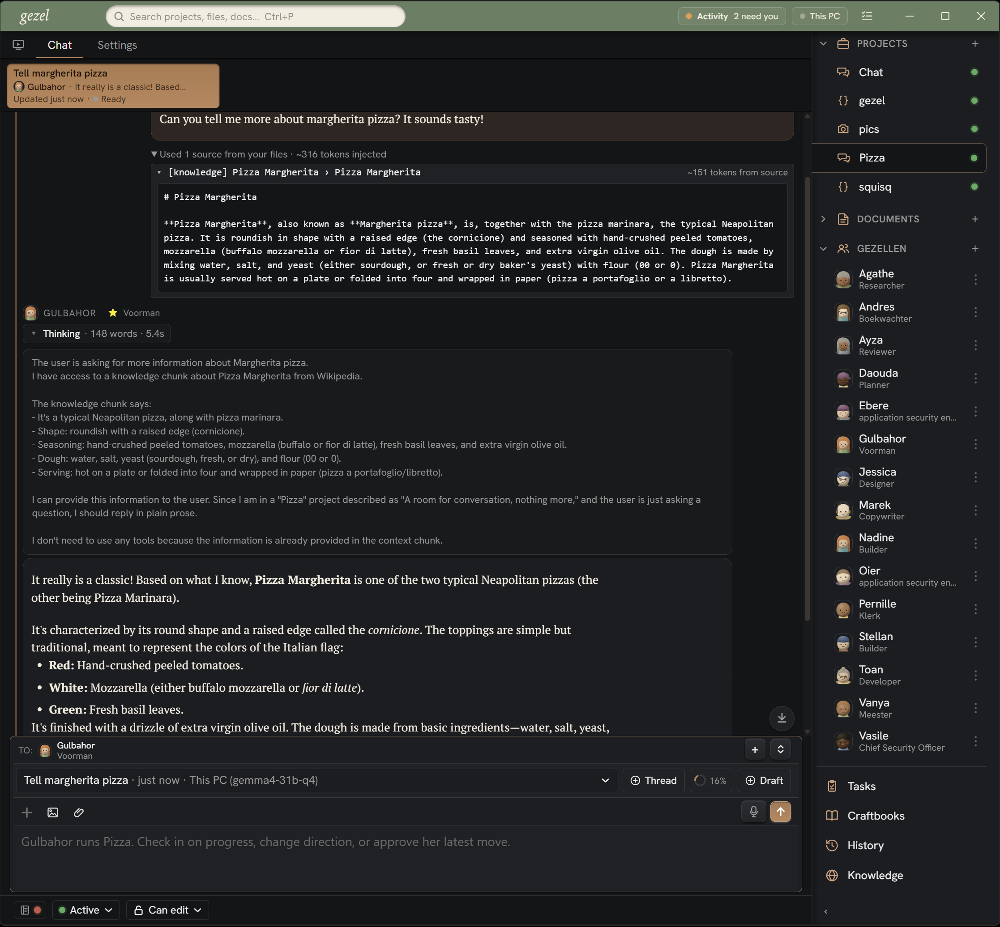
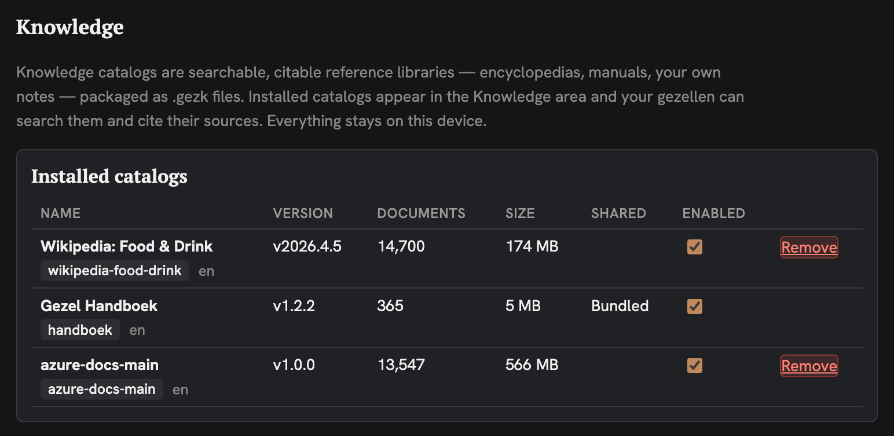
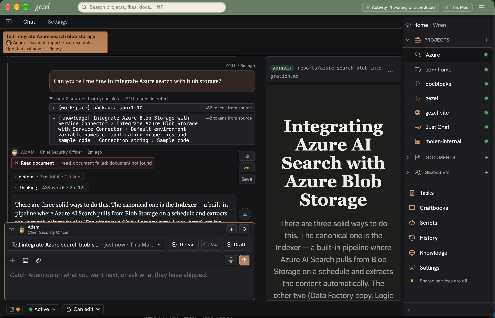
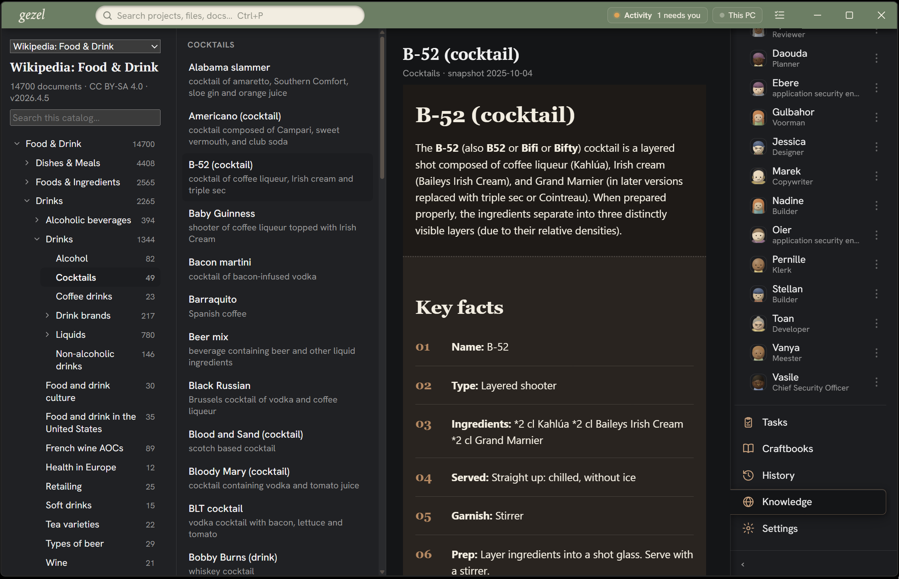

# Gezel and Knowledge {[duration=18.76]}

We're going to talk a little bit about indexing, knowledge, and how to improve the performance of models running locally on your devices.

https://www.youtube.com/watch?v=gus8wVPU5lo

### What is in a Model's Brain? {[duration=71.17]}

First things first: if you haven't seen the [[allaboutlocalmodels]] article about how to think about model sizes, please check it out! In summary: AI models have a size - which you very loosely think about as the "size of its brain" and all the knowledge it contains. If you're running local models, you're probably running things that range from maybe 1 billion parameters - basically, nodes that process how to figure out what the next token should be - and 100 billion parameters. Frontier models are probably in the 2+ trillion parameter range, but some probably go to 10+ trillion parameters.

At around 1-100 billion parameters, they are really not capable of holding a lot of what I'll call "world knowledge" - the intricacy around subjects like music and the arts, or medical, or legal - things like that. It just doesn't fit. If you check out the very informal survey did in the [[allaboutlocalmodels]] topic, you can see that for an obscure topic (all about the city of Issaquah, Washington) - small models basically don't know anything about it. It's only when you get to, say, 30 billion parameters that models have a vibe for some of these esoteric topics.

### How Much Knowledge Actually Fits In There? {[duration=181.84]}

Let's get a bit more detailed about how it works. When we say 30 billion parameters – it's worth focusing on what those parameters are actually doing. A parameter isn't a fact. It's not a drawer in a filing cabinet labeled "capital of France" with a note card inside. What a parameter is, at its most basic, is a number in a giant matrix that nudges the model's attention weights in one direction or another.

I like to think of AI models like Plinko boards from The Price is Right

You put a token in at the top, and it bounces around, and ends up in a bin at the bottom, based on probability. AI vaguely works that way as well: you put in a token at the top: "have a nice \___\_", and it bounces through the model to arrive in the "... day" bucket at the the bottom. To follow the analogy, in the AI model, the nodes are like the "pegs" on the Plinko board: distributed in such a way to make the most probabilistically correct token come out. And so "knowledge" in a model is *distributed* across all those parameters. A single fact like "the boiling point of water is 100 degrees Celsius" isn't stored in one spot. It's smeared across millions of tiny adjustments across the "pegs" of the whole network.

So that has a really important implication: the "knowledge" a model holds is mostly "pattern" knowledge, not "lookup" knowledge. A 30-billion-parameter model has seen enough English text during training that it has a decent feel for grammar, common reasoning patterns, broad cultural references, and the general shape of a lot of topics. But it doesn't have a database. It can't "look up" the 2019 municipal zoning amendment for a specific county. It can't recall the specific clause in a particular contract template your firm uses. The granularity of what a model actually knows -- the long tail of specific, niche, or recent facts -- is much thinner than people expect.

Rough back-of-the-envelope math: a 30B model, trained on maybe a trillion tokens of text, has something like 30 billion floating-point numbers. At 16 bits each, that's roughly 60 gigabytes of *total* capacity. And that has to encode everything—syntax, semantics, reasoning patterns, and whatever "knowledge" got baked in. So the actual "factual content" you can expect to be reliably retrievable from a small local model is a small fraction of that. The model is more like a very well-read person who has the vibe of a lot of subjects but can't necessarily quote the specific page and line. That's the gap we're trying to close.

### RAG: Giving the Model a Notebook {[rightFeature duration=227.99]}

And that's where RAG—Retrieval-Augmented Generation—comes in. The name is a little mouthful, but the idea is pretty simple. You have a body of documents. Your company's internal wiki, a PDF manual, a legal contract, a research paper, whatever. You can't fit all of that into the model's context window, and you definitely can't expect a 7B model to have memorized it during training. So instead, you *retrieve* the relevant pieces and *hand them to the model* right before it generates an answer.

Here's the pipeline in a few steps:

1. **Chunk your documents.** You break your text into smaller pieces—paragraphs, sections, maybe a few hundred tokens (or words) each. You want the chunks small enough to be topically focused but big enough to carry context on their own.

2. **Vectorify each chunk.** You run each chunk through what is called an embedding model (a small neural network whose whole job is to turn text into a long list of numbers that captures the flavor of *meaning* rather than just keywords). It's called embedding, but I find that term confusing, so I'm going to call it "vector-ify". Convert words into a list of numbers. Two chunks about the same topic will land close together in that numeric space; unrelated chunks will be far apart.

3. **Store the embeddings.** You stick those number-vectors into a vector database—in the case of gezel, this is a custom vector implementation on top of sqllite (sqllite-vec) to keep things simple. Each embedding gets tagged with its source chunk and a pointer back to the original text.

4. **At query time, vectorify the question.** The user asks something. You run that question through the same embedding model and get a query vector.

5. **Retrieve.** You ask the vector database for the nearest neighbors to that query vector -- maybe the top 4 or 5 chunks. Those are the pieces of your document most *semantically* relevant to the question.

6. **Re-rank and stuff them into the prompt.** You take those retrieved chunks, run them through a reranker to sharpen their relevance ranking, format the top results into a prompt alongside the user's question, and feed the whole thing to your LLM. The model now has the specific, grounded context it needs to answer accurately, instead of just winging it from whatever patterns it learned during training.

The key concept is that the model isn't doing the remembering. The *retrieval* step is doing the remembering. The model's job shrinks to "here are some relevant passages and a question—write a good answer." That's a much more tractable task, and it's one where even smaller local models can do a solid job. You're essentially giving the model a notebook to peek at before it starts talking.

And because the retrieval is happening *outside* the model, you can swap out the knowledge base at any time. New document? Chunk it, embed it, drop it in the index. The model doesn't need to be retrained. That's the whole appeal for local setups—you get a model that "knows" your specific stuff without needing 2 trillion parameters to memorize it.

### Pre-Packaged Web Search {[duration=72.83]}

One other thing: when you use a frontier model like ChatGPT or Claude, it gives those frontier models the ability to search the web and look for more information. Most local model hosts don't have that option - in part, because generic web search service is not cheap to host, API web search queries cost real money. You'd need to pay someone per web search or be on a monthly plan to do free-form web searches (even if, as a human, you can walk up to google and just use it.) You can try to fake it by pretending to be a human, but that's inherently unreliable.  And, even on my Claude plan, I know I've gotten "limited" by Claude when my chat task causes too many web searches to be fired.

So typically, when you are using free local models, like in Ollama, you're not typically connecting them in with web search services - so in addition to their small size, they also have one hand tied behind their back because they can't fetch more information and details via web search. The knowledge system you see in gezel attempts to partially fill that gap, while still keeping local AI models local, private, and offline. You search your local database rather than the internet. When you think about it, Wikipedia's archive of English-language articles is about 27 gigabytes compressed and its collection of raw data is 170 gigabytes. It's not nothing, but it could fit on a lot of phones (which is a very deep and odd thought for me.) Gezel could get a lot smarter, all locally and for free, if you just give it a couple hundred gigabytes of space to store knowledge.

### Gezel's Knowledge System {[rightFeature duration=80.17]}

In gezel, we now feature this system -- vector search, a built-in RAG, and knowledge concepts, end to end, built in. Gezel can build knowledge from a few sources:

1. The documents you edit are automatically converted into knowledge that is searched. So simply by dumping documents you find relevant, gezel can make them available to models as knowledge
2. Every project you add gets indexed and converted into knowledge, behind the scenes. So if you have a code repository with documents in it, those documents will (eventually) get indexed during the night shift and become available as you edit.
3. You can download pre-built knowledge catalogs
4. You can build and share your own knowledge catalogs: gezk files.

We'll talk about 3 and 4 in just a second.

#### Seeing this in action {[duration=66]}

Let's see how this works in practice. 

Here, I've got a chat I did with AI about "margherita pizzas". Because I've downloaded the "food" knowledge catalog, you can see how knowledge about it was embedded, and how the AI leveraged those to do more searches about margherita pizza vs. trying to make things up on is own.

Now, to be clear, we're still tweaking and improving this integration. Already we see that medium size models - Gemma31b, Qwen 3.827b, can use this information to return better results and be more effective, especially at research related tasks. The jury is still out on tiny models - e.g., Qwen 3.5 4B - and how we can help them be more effective with research. As always, these things take lots of iteration and evals. Stay tuned, I'm pretty optimistic this will be awesome and help close the gap on local models.

#### Pre-built knowledge catalogs {[duration=50.83]}

So to make this easy for everyone, one thing Gezel does is has a growing set of knowledge catalogs you can download: about literature, and space, and law and technology, and more. We're also adding a current events catalog which we intended to update frequently, so that your gezel models can be knowledgable about current events.

#### Bring your own catalog {[duration=72.83]}

We're also looking to make it easy to build your own model catalogs - which you can do by simply using the gezel command line and pointing it at a folder full of documents or markdown files.

For example, Microsoft publishes a lot of their documentation as GitHub repos full of markdown files, and what you can see here is, I pointed the gezel command line at that folder and it generated a gezk file. That single gezk file contains chunks, articles, and vector-ified searchable information. You can upload it into gezel and plug it in to your models' intelligence.

### Bonus: the knowledge browser! {[duration=82.33]}

One more thing: because we have all of this content - we can make it available and searchable inside of gezel as a browsable catalog. So even if you're not feeding AI with it, you can still look up and search information yourself! It becomes an offline content browser, ready to go!

### Summary 

That's how knowledge works in gezel - a key asset for making local models be able to act in a more grounded, more focused form. It's key to getting research and documents just the way you want.
